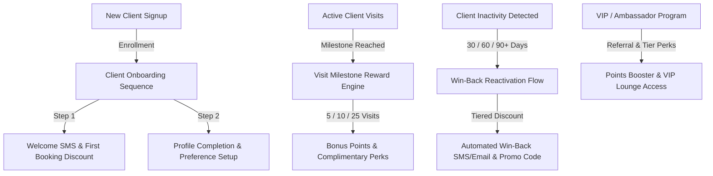

# FADE — Customer Acquisition & Retention Specialist Report

## Mission & Scope
As the autonomous Customer Acquisition and Retention Specialist for **FADE** (`Projects/barbershop/platform`), our mission is to drive sustainable client acquisition, maximize lifetime value (LTV), prevent churn through automated win-back reactivation flows, and reward loyal clients via tiered milestone engines and referral accelerators.

---

## Key Growth & Retention Features Implemented

### 1. Automated Client Onboarding Sequence
- **Purpose**: Seamlessly welcome new clients, capture preferences (haircut style, favorite barber, preferred beverage), and incentivize the first booking with a dynamic discount code.
- **Stages**: `WELCOME_SMS` -> `PROFILE_COMPLETION` -> `FIRST_BOOKING_DISCOUNT` -> `COMPLETED`.

### 2. Tiered Win-Back Reactivation Flow
- **Purpose**: Automatically detect lapsed clients based on days of inactivity (`30`, `60`, `90+` days) and trigger personalized reactivation flows with tiered incentives (`15%`, `20%`, `25%` off).
- **Incentive Generation**: Generates unique trackable promo codes (`WINBACK-90D-XYZ12`) to measure campaign ROI.

### 3. Visit Milestone & Reward Engine
- **Purpose**: Gamify client retention by rewarding milestone visits (`5` visits for Bronze, `10` for Silver, `25` for Gold) with bonus loyalty points and exclusive perks (e.g. Complimentary Styling Product, Free Hot Towel Shave, VIP Lounge Access & Whiskey).

---

## Verification & Testing
All acquisition and retention domain models, use cases, and unit tests have passed successfully under Jest (`retention.spec.ts`, `win-back-engine.spec.ts`, `client-onboarding-engine.spec.ts`).

- **Branch**: `feature/customer-acquisition-retention-specialist-suite-run-2`
- **Target**: `stage`
